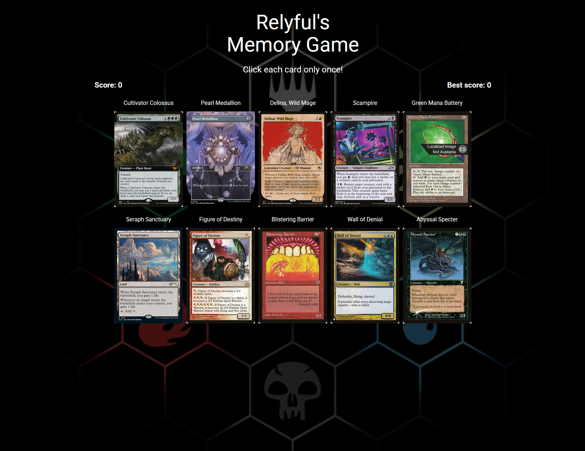

 <div align="center">

<h2> Rely's Memory Game </h2>


<a href="https://relyful-memory-game.vercel.app/">Live Demo</a>



</div>

## 💡 Overview

A simple memory game built with React where players test their memory using randomly generated Magic: The Gathering cards. The objective is to click each card only once while the cards shuffle after every successful selection.

Building this project helped me get more comfortable working with React state, effects, asynchronous API requests and component-based architecture.

## ✨ Features

- Three difficulty levels: Easy (5 cards), Normal (10 cards) and Hard (15 cards).
- Random Magic: The Gathering cards fetched from the Scryfall API.
- Cards shuffle after every successful selection.
- Score tracking and best score tracking.
- Game completion and game-over conditions.
- Option to restart and try a different difficulty.

## 👩‍💻 Tech Stack

- **React:** Frontend library used to build the UI and manage application state.
- **JavaScript:** Main programming language used for the application.
- **Vite:** Development server and build tool.
- **CSS:** Custom styling and layout.

## 📖 Sources and External API's

- **[Scryfall API](https://scryfall.com/docs/api):** Used to fetch random Magic: The Gathering cards, including their names and images.

## 📦 Getting Started

To get a local copy of this project up and running, follow these steps.

### 🚀 Prerequisites

- **Node.js**
- **Npm**

## 🛠️ Installation

1. **Clone the repository:**

   ```bash
   git clone https://github.com/Relyful/odinMemoryGame.git
   cd odinMemoryGame
   ```

2. **Install dependencies:**

   ```bash
   npm install
   ```

3. **Start the development server:**

   ```bash
   npm run dev
   ```

4. Open the local URL provided by Vite in your browser.

No API keys or additional environment variables are required.

## 📜 License

No license specified.
